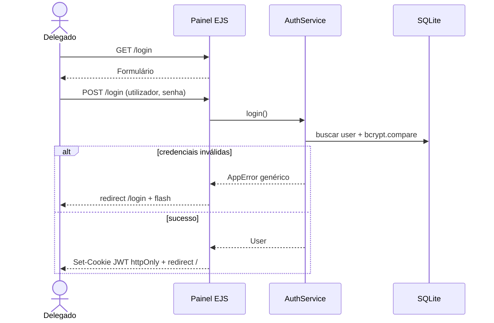
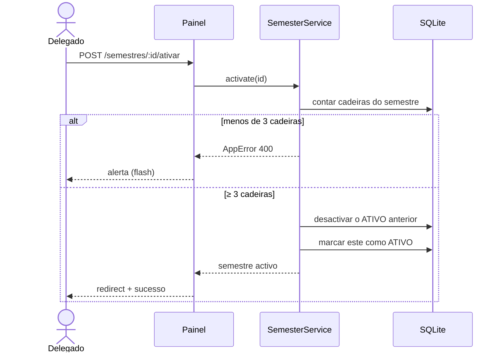
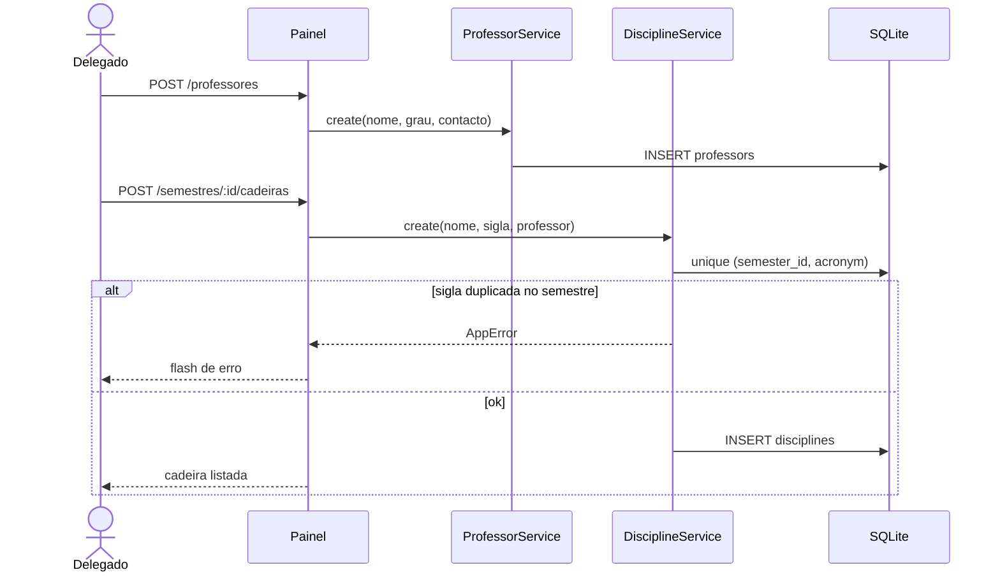
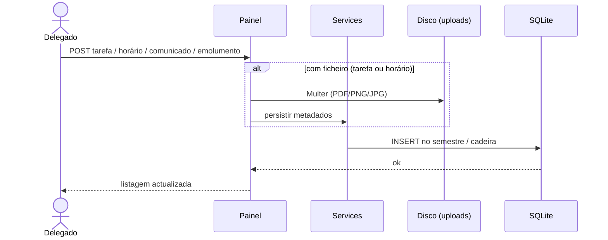
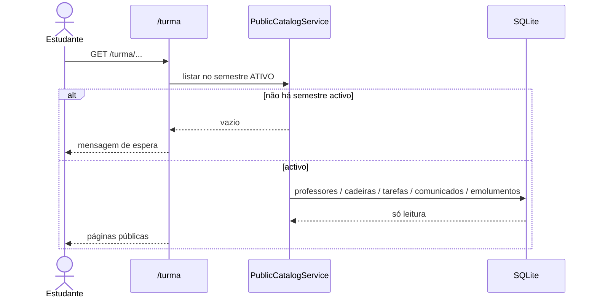
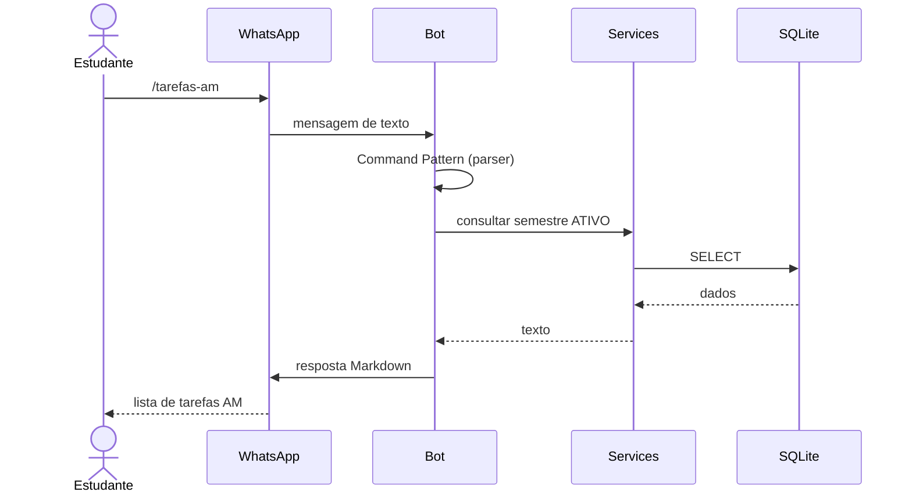
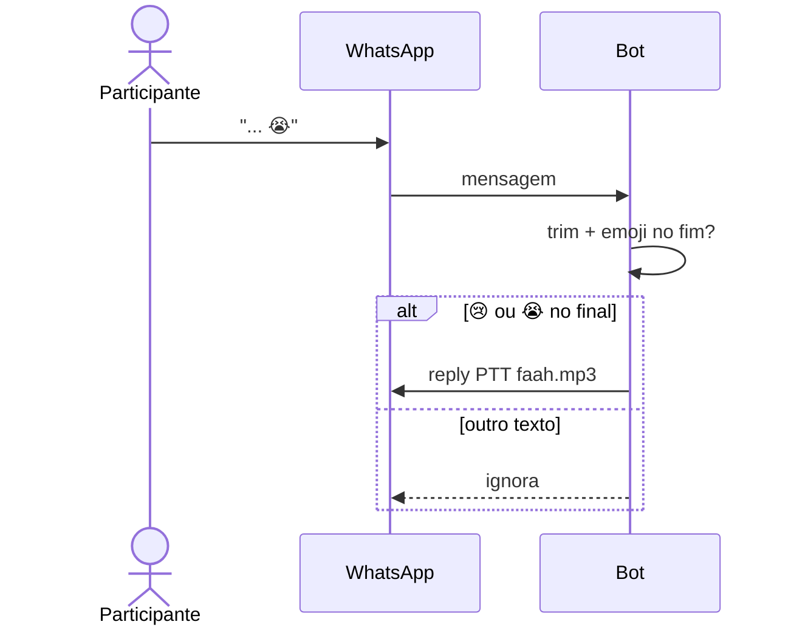
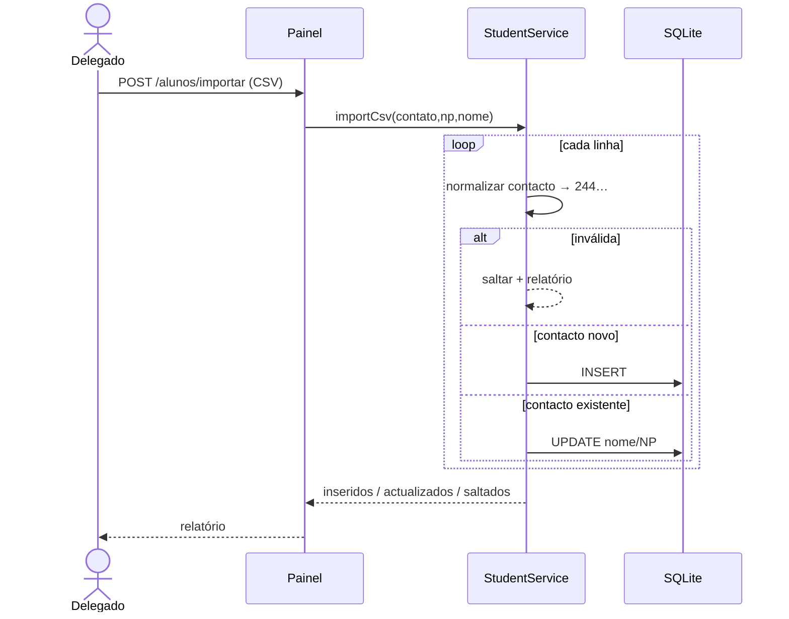

# Diagramas de sequência (casos de uso)

## UC01 — Autenticação do delegado

## UC02 — Activar semestre letivo

## UC03 — Professores e disciplinas

## UC04 — Tarefas, horário, comunicados e emolumentos

## Área do estudante (consulta sem login)

## UC05 — Slash commands no WhatsApp (fase 7, planeado)

## UC06 — Gatilho de emoji (fase 7, planeado)

## Importação CSV de alunos (NP)

